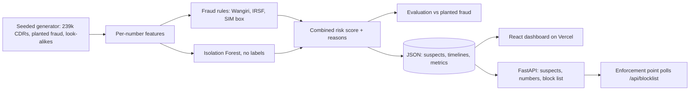

# cdr-fraud-detector

[](https://github.com/momosto/cdr-fraud-detector/actions/workflows/ci.yml)

**Catches Wangiri, IRSF and SIM box fraud in call records by combining telecom fraud rules with machine learning, then shows the suspects, and why each was flagged, on a dashboard.**

Live dashboard: **https://cdr-fraud-detector.vercel.app**

All data is **synthetic**. A seeded generator invents a week of call detail records (CDRs) for a 3,000-subscriber network and plants fraud in it. No real call records, numbers or network data are used.

## What it does

1. **Generates realistic CDRs** with fraud planted in two forms: an *obvious* version that matches textbook patterns, and a *stealthy* version built to stay under rule thresholds. It also plants **legitimate look-alikes**: busy business lines, diaspora callers who phone abroad for hours, and Wangiri victims who ring back.
2. **Builds per-number behaviour features**: calls per day, share of 3-second calls, incoming-to-outgoing ratio, share to premium-risk ranges, night share, cells used, SIMs per handset, busiest hour and more.
3. **Applies fraud rules** that an analyst would write:
   - **Wangiri**: a foreign number makes 50+ calls in an hour, 80% of them 3 s or less.
   - **IRSF**: 20+ calls or 120+ minutes to premium-risk ranges in a single day.
   - **SIM box**: 100+ calls a day from at most two cells with almost nothing incoming, or a handset shared by 3+ SIMs.
4. **Scores every number with an Isolation Forest.** The model gets no fraud labels; it learns what normal calling looks like and ranks how unusual each number is.
5. **Combines both** into one risk score with reasons, taken from the real output:
   - "rule: Handset shared by 16 different SIMs"
   - "model: outlier, top 1.0% of numbers (average call length (s) 5.03, share of calls of 3 s or less 0.72)", for the stealthy Wangiri number that no rule catches
6. **Measures itself** against the planted fraud: precision, recall, recall per variant, and who the false alarms were.
7. **Serves a block list** for an enforcement point (IMS, SBC or switch) through a small API.

## Results

On the default run, 238,899 CDRs, 4,839 numbers scored and 57 planted fraud numbers:

| Method | Flagged | Precision | Recall | F1 |
|---|---|---|---|---|
| Rules only | 43 | **1.00** | 0.75 | 0.86 |
| Isolation Forest only (top 1.5%) | 73 | 0.64 | **0.82** | 0.72 |
| Rules + model | 73 | 0.64 | **0.82** | 0.72 |

Ranking quality (average precision): model score 0.86, **combined risk 0.89**. Across 5 differently seeded networks (`python -m cdrfraud.benchmark`) the combined average precision is 0.89 (range 0.88–0.90), and precision and recall at the flag threshold are the same on every seed.

**Fraud caught, by variant** (all five seeds summed):

| Planted fraud | Rules | Model | Rules + model |
|---|---|---|---|
| Wangiri, obvious | 15/15 | 15/15 | 15/15 |
| Wangiri, stealthy | 0/5 | **5/5** | 5/5 |
| IRSF, obvious | 40/40 | 40/40 | 40/40 |
| IRSF, stealthy | 0/15 | **15/15** | 15/15 |
| SIM box, obvious | 160/160 | 160/160 | 160/160 |
| SIM box, stealthy | 0/50 | **0/50** | 0/50 |

**What this shows**

- **Rules are precise but only find what they were written for.** Every rule hit was real fraud, and every stealthy variant got past them.
- **The model, with no labels, finds the stealthy Wangiri and IRSF numbers**, because they are still unusual even when they stay under every threshold.
- **The model's false alarms are explainable.** In the default run they were 11 diaspora callers, 9 ordinary subscribers and 6 Wangiri victims who rang back a premium number. That's why only rule-confirmed numbers go on the block list automatically, and model-only flags go to an analyst.
- **The low-volume SIM box is the real gap.** Ten SIMs making 40–70 calls a day from their own handsets look much like a busy normal user on these features; the model ranks them around the top 3%, short of the 1.5% flag line. Catching them needs relationship features (SIM boxes call numbers that never call back), which is next on the roadmap.
- **The synthetic patterns are cleaner than real traffic**, which is why the scores barely move between seeds. Treat these numbers as a demonstration of the method, not a production benchmark.

## Run it in 2 minutes

```bash
git clone https://github.com/momosto/cdr-fraud-detector && cd cdr-fraud-detector
docker compose up --build        # dashboard on http://localhost:8000, API under /api
```

Without Docker:

```bash
python -m venv .venv && . .venv/bin/activate        # Windows: .venv\Scripts\activate
pip install -r requirements-dev.txt
python -m cdrfraud.pipeline --out dashboard/public/data --cdrs data/cdrs.csv.gz   # ~20 s
python -m cdrfraud.benchmark                         # 5 seeds, ~1 min
pytest -q
uvicorn cdrfraud.api:app --reload                    # API on http://localhost:8000/api/...
cd dashboard && npm install && npm run dev           # dashboard on http://localhost:5173
```

## How it works



| Endpoint | Purpose |
|---|---|
| `GET /api/blocklist?min_risk=0.9` | Numbers to bar, with type, risk and the reason. Default: rule-confirmed only |
| `GET /api/suspects?min_risk=&fraud_type=&limit=` | Ranked suspects with reasons and ground truth |
| `GET /api/numbers/{number}` | One suspect, including hourly calls made and received for the week |
| `GET /api/metrics` | Precision, recall and per-variant results for the latest run |

## The dashboard

- Precision and recall per method, and fraud caught by variant
- Who the false alarms were
- A filterable suspect list showing what each number really is, so mistakes stay visible
- For each suspect: the reasons, and a **7-day × 24-hour grid** of calls made and received, where the patterns are easy to see. Wangiri is one bright burst, IRSF is a block of night-time calls, and a SIM box is a solid wall with nothing coming in.

The dashboard is static: React reads the JSON files the pipeline writes, so it loads instantly on Vercel and has no server to keep running. Charts are plain HTML and CSS, with a colour-blind-checked palette and text labels next to every colour.

## Project layout

```
cdrfraud/generator.py   synthetic CDRs, planted fraud, legitimate look-alikes
cdrfraud/features.py    per-number features and hourly activity
cdrfraud/detect.py      rules, Isolation Forest, combined risk and reasons
cdrfraud/evaluate.py    precision, recall, per-variant recall, false-alarm cohorts
cdrfraud/pipeline.py    run everything, write dashboard JSON
cdrfraud/benchmark.py   repeat over several seeds
cdrfraud/api.py         FastAPI: suspects, numbers, block list (+ serves the dashboard in Docker)
dashboard/              React + TypeScript + Vite dashboard
tests/                  generator, features, rules, model, pipeline and API tests
```

## Roadmap

- **Relationship features for SIM boxes**: the share of called numbers that ever call back, and calls into the network that arrive from international gateways
- **Streaming mode**: replay CDRs through Redis Streams and score per hour, so a Wangiri burst is flagged while it is happening
- **Per-cell baselines**, so a busy CBD cell isn't compared with a rural one

MIT licensed. Built by [Simbarashe Nyamusa](https://simbarashe-nyamusa.vercel.app) as a public, coded version of a VoIP fraud management design; no employer code or data is used.
